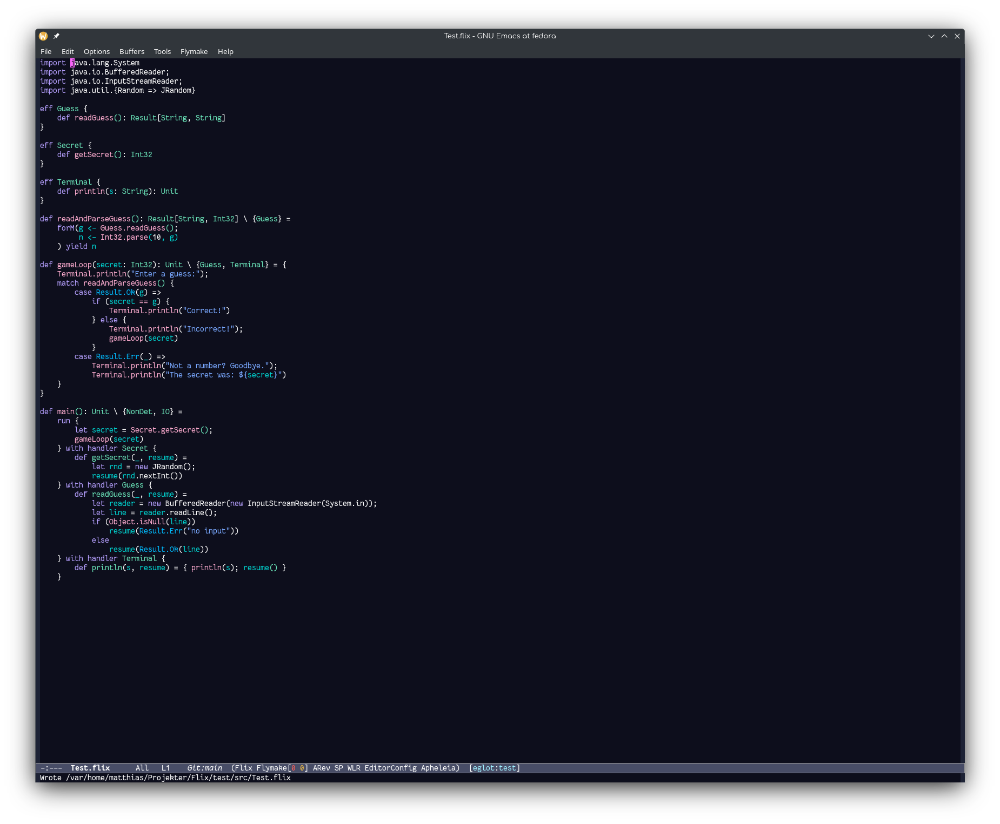

# Flix mode for Emacs

This mode for the Flix programming language offloads all work to the excellent LSP server that
exists within the Flix compiler. What is provided is a major mode for use in various hooks, and
functions to parse the Flix project configuration file (flix.toml by default).



## How it works

The `flix-mode` by itself has no functionality; it is a major mode derived from `prog-mode`,
intended only to enable the hooks we can use in other modes to enable functionality for Flix
buffers.

Two supporting functions are defined:

- `flix-mode-server-path` finds the path to the Flix jar file based on the project `flix.toml` file
- `flix-mode-ensure` ensures that a Flix jar matching the version in `flix.toml` is present,
  prompting the user to download it if necessary

See the example config below for how to use these functions.

## Minimal configurations

### Eglot

**Dependencies**

- flix-mode (this repo, install using `M-x package-vc-install` and pasting this URL)
- eglot (comes bundled with newer emacs versions, but run `M-x eglot-upgrade-eglot` to ensure you have the latest version)
- eglot-supplements (adds some missing pieces to eglot: https://codeberg.org/harald/eglot-supplements )
- eglot-booster (speeds up eglot and provides a more robust JSON parser: https://github.com/jdtsmith/eglot-booster )
- toml (use https://github.com/gongo/emacs-toml)

**Notes**

On opening the first file in a project the LSP server will be started automatically, but it might
not be ready for supplying semantic tokens immediately. If you open a new Flix buffer, highlighting
will turn on immediately, but sometimes (always?) it will be necessary to run `M-x
eglot-semtok-request-fontification` in the first buffer you open.

```elisp
;; This is not just the toml package in MELPA
(use-package toml
  :vc (:url "https://github.com/gongo/emacs-toml"
            :branch "master"))

(use-package flix-mode
  :vc (:url "https://github.com/flix/emacs"
            :branch "master")
  :mode "\\.flix\\'"

  :hook ((flix-mode . flix-mode-ensure))

  :commands flix-mode)

;; Eglot configuration (please make sure to run M-x eglot-upgrade-eglot)
(use-package eglot
  :hook ((flix-mode . eglot-ensure))

  ;; This is how we tell eglot where to find the Flix compiler jar
  :config
  (add-to-list 'eglot-server-programs
               '(flix-mode . flix-mode-server-path)))

;; The emacs JSON parser does not like the line-endings sent by the Flix LSP, so using
;; the external parser provided by the eglot-booster package is necessary. This is not
;; all bad, as using it will make eglot more responsive across languages.
;;
;; See the eglot-booster documentation for how to install it.
(use-package eglot-booster
  :after eglot
  :config (eglot-booster-mode))

;; You will want to have syntax highlighting based on the LSP connection. Unfortunately
;; eglot does not support that out of the box. Fortunately, Harald Kirsch has made the
;; eglot-supplements package, which contains among other things the missing semantic tokens
;; support.

(use-package eglot-supplements
  :vc (:url "https://codeberg.org/harald/eglot-supplements"))

;; eglot-semtok is the semantic tokens implementation in eglot-supplements. It comes with
;; some default coloring, but that is mostly configured to showcase different configuration
;; options. Use the below configuration to set up the faces to match whatever your theme
;; is; then go crazy with your own customizations afterwards if you want. :-)
(use-package eglot-semtok
  :load-path "elpa/eglot-supplements/"
  :hook ((eglot-connect . eglot-semtok-on-connected)
         (flix-mode . eglot-semtok-font-lock-init))
  :config
  (setq eglot-semtok-faces
        '("class"
          (("" "" font-lock-type-face))
          "interface"
          (("" "" font-lock-type-face))
          "typeParameter"
          (("" "" font-lock-type-face))
          "parameter"
          (("" "" font-lock-variable-name-face))
          "variable"
          (("" "" font-lock-variable-name-face))
          "property"
          (("" "" font-lock-constant-face))
          "enumMember"
          (("" "" font-lock-constant-face))
          "function"
          (("" "" font-lock-function-name-face))
          "method"
          (("" "" font-lock-function-name-face))
          "member"
          (("" "" font-lock-property-name-face))
          "keyword"
          (("" "" font-lock-keyword-face))
          "modifier"
          (("" "" default))
          "decorator"
          (("" "" font-lock-keyword-face))
          "annotation"
          (("" "" font-lock-keyword-face))
          "type"
          (("" "" font-lock-type-face))
          "string"
          (("" "" font-lock-string-face))
          "number"
          (("" "" font-lock-number-face))
          "comment"
          (("" "" font-lock-comment-face)))))
```

### lsp-mode

**Dependencies**

- flix-mode (this repo, install using `M-x package-vc-install` and pasting this URL)
- lsp-mode (available on MELPA: https://github.com/emacs-lsp/lsp-mode )
- toml (use https://github.com/gongo/emacs-toml)

**Notes**

`lsp-mode` provides semantic tokens support out of the box, so no extra package
is needed for LSP-based highlighting; it just has to be enabled (see below).

The Flix LSP server resolves the LSP `workspaceFolder` name as a *relative*
path when it scans the project. Because `lsp-mode` sends the directory's short
name rather than a full path, the server's working directory has to be the
**parent** of the workspace root for the project scan to succeed. Without this,
only the opened file is compiled and you get `Orphaned module` / `Undefined
use` errors. The advice below handles that.

flix-mode locates the project (and thus the compiler jar) through `project.el`.
On plain Emacs, `project.el` doesn't know that `flix.toml` marks a project
root, so the config below registers a `project-find-functions` entry for it.

```elisp
;; This is not just the toml package in MELPA
(use-package toml
  :vc (:url "https://github.com/gongo/emacs-toml"
            :branch "master"))

;; Let project.el recognize a Flix project by its flix.toml, so that
;; flix-mode's project-based jar resolution works. (flix-mode locates the
;; project via project.el; without this, plain Emacs doesn't know flix.toml
;; marks a project root.)
(require 'project)
(defun flix/project-find (dir)
  (when-let ((root (locate-dominating-file dir "flix.toml")))
    (cons 'transient root)))
(add-to-list 'project-find-functions #'flix/project-find)

(use-package flix-mode
  :vc (:url "https://github.com/flix/emacs"
            :branch "master")
  :mode "\\.flix\\'"

  ;; Enable semantic tokens (server-provided highlighting) before LSP starts,
  ;; then start the server.
  :hook ((flix-mode . (lambda ()
                        (setq-local lsp-semantic-tokens-enable t)
                        (lsp-deferred))))

  :commands flix-mode)

;; lsp-mode configuration
(use-package lsp-mode
  :commands (lsp lsp-deferred)
  :init
  ;; Set the server's working directory to the parent of the workspace root in
  ;; flix-mode buffers, so the Flix LSP server's relative-path project scan
  ;; resolves correctly.
  (defun flix/lsp-default-directory-parent-of-root (orig-fn &rest args)
    (if (derived-mode-p 'flix-mode)
        (let ((root (lsp-workspace-root)))
          (if root
              (file-name-directory (directory-file-name root))
            (apply orig-fn args)))
      (apply orig-fn args)))

  :config
  (add-to-list 'lsp-language-id-configuration '(flix-mode . "flix"))
  (advice-add 'lsp--default-directory-for-connection :around
              #'flix/lsp-default-directory-parent-of-root)
  ;; Register the Flix LSP client: launch the compiler jar in LSP mode.
  ;; flix-mode-ensure downloads the jar if needed; flix-mode-server-path
  ;; returns ("java" "-jar" <jar> "lsp").
  (lsp-register-client
   (make-lsp-client
    :new-connection (lsp-stdio-connection
                     (lambda ()
                       (flix-mode-ensure)
                       (flix-mode-server-path nil)))
    :activation-fn (lsp-activate-on "flix")
    :server-id 'flix-ls)))
```

## Customizing

A customizing group `flix-mode` contains the variables that can be customized.
